# salas-post1-u7

## Descripción

Laboratorio de la Unidad 7 de Arquitectura de Computadores (post-contenido): manejo de pantalla y teclado en NASM, ejecutado sobre DOSBox, en un único repositorio.

- **Estudiante:** Cesar Hernan Salas Peñaranda (cuenta de GitHub `cesarhernansp`)
- **Parte 1:** salida de texto con `INT 21h` y control de pantalla con `INT 10h` (cursor, color, cadenas en posición exacta), más la consulta del modo de video (`AH=0Fh`) y la relectura de una celda (`AH=08h`).
- **Parte 2:** lectura de teclado con `INT 16h` (scan codes y byte de estado `AH=02h`) y escritura directa en el segmento de video `B800h`, con un mini editor y un indicador de Shift/Ctrl en tiempo real.

## Entorno de trabajo

| Componente | Versión / detalle |
|---|---|
| Sistema anfitrión | Windows 11 Home, 16 GB de RAM |
| Emulador | DOSBox 0.74-3 |
| Ensamblador | NASM 3.02 para DOS (`nasm.exe`, requiere el host DPMI `cwsdpmi.exe`) |
| Editor | VS Code / editor de texto plano; archivos `.asm` en ASCII sin BOM |

`nasm.exe` y `cwsdpmi.exe` se copian a la raíz del proyecto (que se monta como `C:\`), pero no se versionan por ser binarios de terceros.

## Compilación y ejecución

```
Z:\> mount C C:\Users\Cesar\salas-post1-u7
Z:\> C:
C:\> cwsdpmi -p
C:\> nasm -f bin post1.asm -o post1.com
C:\> post1.com
```

La misma secuencia se aplica a cada programa (`post1b`, `post1c`, `post1d`, `post2a`, `post2b`, `post2c`, `post2d`, `post2e`). Todos los nombres respetan el formato 8.3 de DOS.

## Capturas

Las capturas de `capturas/` son imágenes de la ventana de DOSBox (o de la consola de Windows) tal como se obtuvieron, sin recortes, ampliaciones ni retoques.

## Estructura del repositorio

```
salas-post1-u7/
├── README.md       # documentación de ambas partes
├── dosbox.conf     # configuración de DOSBox
├── post1.asm/.com  post1b.asm/.com  post1c.asm/.com  post1d.asm/.com   # Parte 1
├── post2a.asm/.com post2b.asm/.com  post2c.asm/.com  post2d.asm/.com  post2e.asm/.com   # Parte 2
└── capturas/       # capturas de compilación y de ejecución de cada checkpoint
```

## Parte 1: INT 21h e INT 10h

Los cuatro programas son `.COM` (`ORG 100h`) con la estructura `section .data` / `section .text`. En `-f bin`, NASM coloca `.text` antes que `.data` en el archivo de salida aunque `.data` aparezca primero en el fuente (`post1.com` empieza con `B4 09`, es decir `mov ah, 09h`), de modo que la ejecución comienza en la primera instrucción.

### Interrupciones utilizadas

| Interrupción y función | Registros de entrada | Retorno / efecto | Dónde se usa |
|---|---|---|---|
| `INT 21h` / `AH=09h` | `DS:DX` → cadena terminada en `$` | imprime la cadena en el color actual de la pantalla; no admite atributo | `post1`, mensajes de `post1d` |
| `INT 21h` / `AH=02h` | `DL` = carácter | imprime un carácter | dígitos hexadecimales del modo en `post1d` |
| `INT 21h` / `AH=07h` | — | `AL` = tecla leída, sin eco; espera una pulsación | pausa final de `post1b`, `post1c` y `post1d` |
| `INT 21h` / `AH=4Ch` | `AL` = código de retorno | termina el programa | todos |
| `INT 10h` / `AH=06h` | `AL` = líneas (0 = limpiar), `BH` = atributo de relleno, `CX` = esquina superior izquierda, `DX` = inferior derecha | desplaza una ventana; con `AL = 0` y `DX = 184Fh` limpia toda la pantalla | `post1b`, `post1c` |
| `INT 10h` / `AH=02h` | `BH` = página, `DH` = fila, `DL` = columna | posiciona el cursor | `post1b`, `post1c`, `post1d` |
| `INT 10h` / `AH=09h` | `AL` = carácter, `BH` = página, `BL` = atributo, `CX` = repeticiones | escribe un carácter con atributo en la posición del cursor; **no** avanza el cursor | `post1b`, `post1c`, `post1d` |
| `INT 10h` / `AH=0Fh` | — | `AL` = modo de video activo, `AH` = columnas, `BH` = página activa | `post1d` |
| `INT 10h` / `AH=08h` | `BH` = página | `AL` = carácter y `AH` = atributo de la celda bajo el cursor (operación inversa de `AH=09h`) | `post1d` |

**Byte de atributo.** Los 4 bits altos son el color de fondo y los 4 bajos el color del texto. Por ejemplo `1Eh` = `0001 1110b` es fondo azul (1) con texto amarillo (E), `0Ch` es texto rojo claro sobre negro, `0Ah` es verde claro sobre negro y `2Fh` es fondo verde (2) con texto blanco brillante (F).

### Programas y resultados

| Programa | Qué hace | Resultado observado |
|---|---|---|
| `post1.asm` | Imprime tres cadenas con una sola función, `INT 21h` / `AH=09h` | Las tres líneas: `Arquitectura de Computadores`, `Unidad 7: Pantalla y Teclado`, `Laboratorio POST-1` |
| `post1b.asm` | Limpia la pantalla (`AH=06h`), posiciona el cursor (`AH=02h`) y escribe con color (`AH=09h`) | `A` amarilla sobre azul en la fila 2, columna 10; `U7` en rojo claro en la fila 3, columnas 10 y 11 |
| `post1c.asm` | Recorre una cadena posicionando el cursor y escribiendo un carácter con atributo en cada vuelta | `UNIDAD 7 - PANTALLA Y TECLADO` en verde claro, fila 5, desde la columna 25 (29 caracteres, centrado en 80 columnas) |
| `post1d.asm` | Consulta el modo con `AH=0Fh`, escribe `Z` con atributo `2Fh` y la relee con `AH=08h` | `Modo de video: 03h`, `Modo texto 80x25 confirmado (03h)`, `Z` en fila 8 columna 10 y `Verificacion OK: caracter y atributo releidos coinciden` |

### Notas de implementación

- **`post1d.asm` guarda el modo en memoria.** El código del enunciado deja el modo en `DL` y a continuación carga `DX` con la dirección de `msgModo`, lo que sobrescribe `DL`; la comparación con `03h` evaluaría entonces parte de una dirección y no el modo de video. El programa lo guarda en la variable `modo_video` y compara contra ese valor. Además imprime el modo en hexadecimal para que el reporte muestre explícitamente `03h`.
- **Constantes con nombre.** Los atributos de color, las filas y columnas de prueba, el modo esperado y los terminadores se definen con `equ` al inicio de cada programa, en lugar de usar valores mágicos.
- **`AH=09h` no mueve el cursor.** Por eso `post1b` reposiciona el cursor a mano antes de cada carácter y `post1c` incrementa la columna en `DL` en cada vuelta del bucle.

### Capturas de la Parte 1

Para cada checkpoint hay una captura de la compilación (`nasm -f bin ... ; dir`) y otra de la ejecución.

| Checkpoint | Compilación | Ejecución / verificación |
|---|---|---|
| 1. Salida básica (`post1`) | `capturas/p1_cp1a_compilacion_post1.png` | `capturas/p1_cp1b_ejecucion_post1.png` |
| 2. Cursor y color (`post1b`) | `capturas/p1_cp2a_compilacion_post1b.png` | `capturas/p1_cp2b_ejecucion_post1b.png` |
| 3. Cadena posicionada (`post1c`) | `capturas/p1_cp3a_compilacion_post1c.png` | `capturas/p1_cp3b_ejecucion_post1c.png` |
| 4. Modo de video y relectura (`post1d`) | `capturas/p1_cp4a_compilacion_post1d.png` | `capturas/p1_cp4b_ejecucion_post1d.png` |
| 5. Decisiones técnicas | `capturas/p1_cp5a_decision1.png` (recuento de palabras) | `capturas/p1_cp5b_decision2.png` (recuento de palabras) |

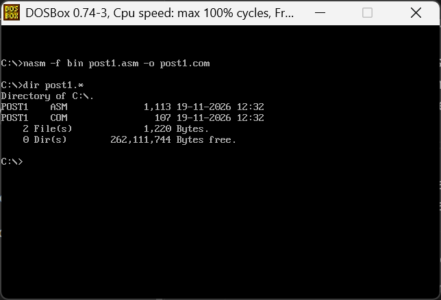
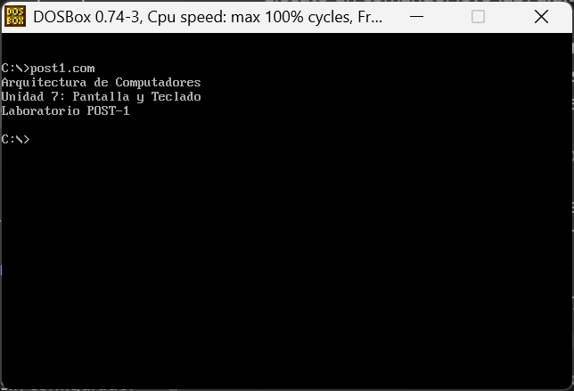


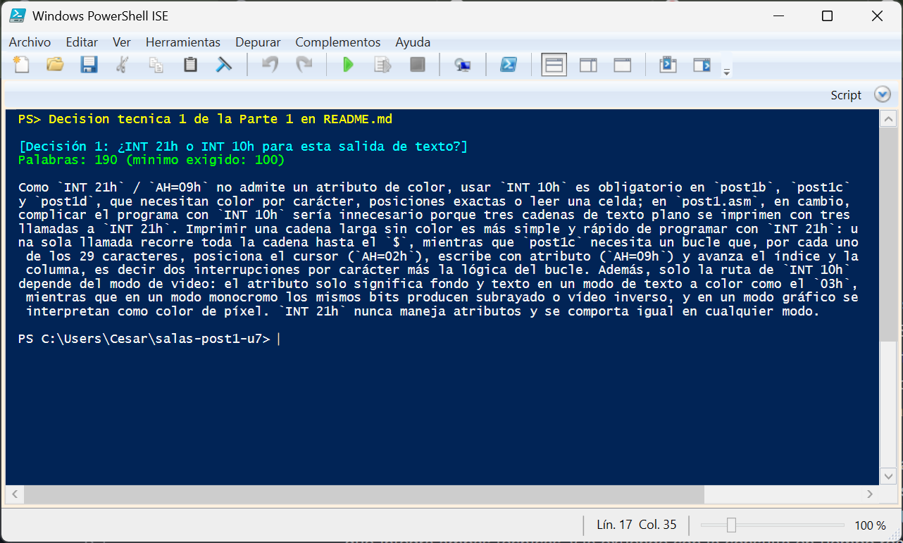


## Decisiones técnicas (Parte 1)

### Decisión 1: ¿INT 21h o INT 10h para esta salida de texto?

Como `INT 21h` / `AH=09h` no admite un atributo de color, usar `INT 10h` es obligatorio en `post1b`, `post1c` y `post1d`, que necesitan color por carácter, posiciones exactas o leer una celda; en `post1.asm`, en cambio, complicar el programa con `INT 10h` sería innecesario porque tres cadenas de texto plano se imprimen con tres llamadas a `INT 21h`. Imprimir una cadena larga sin color es más simple y rápido de programar con `INT 21h`: una sola llamada recorre toda la cadena hasta el `$`, mientras que `post1c` necesita un bucle que, por cada uno de los 29 caracteres, posiciona el cursor (`AH=02h`), escribe con atributo (`AH=09h`) y avanza el índice y la columna, es decir dos interrupciones por carácter más la lógica del bucle. Además, solo la ruta de `INT 10h` depende del modo de video: el atributo solo significa fondo y texto en un modo de texto a color como el `03h`, mientras que en un modo monocromo los mismos bits producen subrayado o vídeo inverso, y en un modo gráfico se interpretan como color de píxel. `INT 21h` nunca maneja atributos y se comporta igual en cualquier modo.

### Decisión 2: ¿por qué verificar el modo de video y releer una celda en lugar de asumir su estado?

Si el modo activo no fuera `03h`, `post1b` y `post1c` podrían mostrar algo distinto a lo esperado: en un modo de 40 columnas, el título de `post1c` (que ocupa las columnas 25 a 53) se saldría de la pantalla; en un modo monocromo, el atributo `1Eh` produce un efecto distinto al fondo azul y texto amarillo; y en un modo gráfico el texto no se dibuja como se supone. `AH=0Fh` es la forma correcta de comprobarlo porque devuelve el modo real, el número de columnas y la página, en lugar de suponerlos fijos en el código. Releer la celda con `AH=08h` aporta una confirmación que escribir con `AH=09h` no da: detecta si algo modificó o no almacenó el carácter y el atributo, lo que en un editor de pantalla evita un error silencioso, como seguir adelante creyendo que la pantalla refleja lo escrito. Frente al acceso directo a `B800h` de la Parte 2, `AH=08h` es portable entre modos y páginas sin conocer la aritmética de segmento y desplazamiento, pero es más lento; `B800h` es mucho más rápido y no necesita cursor, pero exige conocer de antemano el modo y el formato de la memoria de video.

## Parte 2: INT 16h y acceso directo a B800h

Los cinco programas son `.COM` (`ORG 100h`). Los valores que no cambian (segmento de video, número de columnas, atributos de color, máscaras de bits y posiciones) se definen con `equ` al inicio de cada programa, y el cálculo del desplazamiento de una celda se encapsula en una macro, `OFFSET_CELDA(fila, col)`, que NASM evalúa al ensamblar.

### Interrupciones y memoria de video utilizadas

| Elemento | Detalle | Dónde se usa |
|---|---|---|
| `INT 16h` / `AH=00h` | espera una tecla; `AH` = scan code, `AL` = ASCII (`AL = 00h` en teclas extendidas) | `post2a`, `post2d`, `post2e` (para consumir la tecla) |
| `INT 16h` / `AH=01h` | consulta no bloqueante del buffer; `ZF = 1` si no hay tecla | `post2e` |
| `INT 16h` / `AH=02h` | `AL` = byte de estado de teclas modificadoras (`0040h:0017h`), sin esperar ninguna tecla | `post2e` |
| Segmento `B800h` | memoria de video en modo texto 80×25; se accede con `ES:DI` | `post2b`, `post2c`, `post2d`, `post2e` |
| `REP STOSW` | guarda `AX` en `ES:DI` y suma 2 a `DI`, repetido `CX` veces | `post2c`, `post2d`, `post2e` |

**Fórmula del desplazamiento de una celda.** Cada celda ocupa 2 bytes consecutivos: el código ASCII en el desplazamiento par y el atributo en el siguiente.

```
offset = (fila * 80 + columna) * 2         carácter en B800h:offset, atributo en B800h:offset+1
```

Ejemplos verificados por el ensamblador: fila 10, columna 35 → `(10*80 + 35) * 2 = 1670`; fila 11 → 1830; fila 12 → 1990; fila 13 → 2150; fila 12, columna 30 → 1980; fila 0, columna 6 → 12; fila 0, columna 13 → 26.

**Byte de atributo.** `[fondo (4 bits)][texto (4 bits)]`. Con `STOSW`, `AL` es el carácter y `AH` el atributo, por lo que `1720h` equivale a un espacio (`20h`) con atributo `17h`.

**Byte de estado de `AH=02h`** y la extracción de los bits que usa `post2e`:

| Bit | 7 | 6 | 5 | 4 | 3 | 2 | 1 | 0 |
|---|---|---|---|---|---|---|---|---|
| Significado | Insert | CapsLock | NumLock | ScrollLock | Alt | **Ctrl** | **Shift izq.** | **Shift der.** |

`MASK_SHIFT = 03h` (bits 0 y 1) y `MASK_CTRL = 04h` (bit 2); el programa aplica `test bl, MASK_...` al byte de estado y muestra `1` si algún bit de la máscara está activo.

### Programas y resultados

| Programa | Qué hace | Resultado observado |
|---|---|---|
| `post2a.asm` | Lee teclas con `INT 16h` / `AH=00h` y muestra scan code y ASCII en hexadecimal hasta Escape | Flecha arriba: `Scan: 48 ASCII: 00`; `a`: `1E` / `61`; F1: `3B` / `00`; Enter: `1C` / `0D`. Las teclas extendidas dan ASCII `00`. Escape devuelve al prompt |
| `post2b.asm` | Escribe cuatro letras directamente en `B800h` | `H`, `O`, `L`, `A` en la columna 35, filas 10 a 13, en blanco brillante, amarillo, verde claro y rojo claro |
| `post2c.asm` | Rellena las 2000 celdas con `REP STOSW` y escribe un mensaje | Pantalla completa con fondo azul y `HOLA DESDE B800h` en blanco brillante sobre azul, fila 12, columna 30 |
| `post2d.asm` | Mini editor de una línea: `INT 16h` para leer, `B800h` para escribir | Se escribió `Hola Mundoo`, Retroceso borró la `o` sobrante y la fila 12 quedó con `Hola Mundo`; Enter terminó el programa |
| `post2e.asm` | Sondea `AH=02h` en bucle y muestra Shift y Ctrl en la fila 0 | Sin teclas: `SHIFT:0 CTRL:0`. Con Shift mantenido: `SHIFT:1 CTRL:0`. Con Ctrl mantenido: `SHIFT:0 CTRL:1`. Al soltar vuelve a `0` y `0`. Escape termina |

### Notas de implementación

- **`post2d.asm` lee cada tecla una sola vez.** El código del enunciado llama dos veces a `INT 16h` por carácter (el propio enunciado lo describe como simplificación didáctica) y compara `BL`, que no contiene nada útil, por lo que el usuario tendría que pulsar cada tecla dos veces. El programa guarda `AL` en `CL` justo después de la primera lectura, calcula el desplazamiento con `AX` y escribe `CL` en pantalla. Además limpia la pantalla con `REP STOSW`, muestra una línea de ayuda y soporta Retroceso (ASCII `08h`).
- **`post2c.asm` usa el atributo `1Fh` para el mensaje.** El enunciado indica texto blanco brillante sobre azul, pero el código usa `0Fh`, cuyo fondo es negro. Se usa `1Fh` (fondo azul, texto blanco brillante), de modo que el mensaje se ve sobre el fondo azul como describe el checkpoint.
- **`post2e.asm` limpia la pantalla** al empezar y sondea sin bloquearse: la lectura de la tecla (`AH=00h`) solo se hace cuando `AH=01h` indica que hay una en el buffer.
- **Teclas modificadoras en las capturas.** Para mantener Shift o Ctrl se emitieron eventos reales de pulsación y liberación de teclado hacia la ventana de DOSBox; el BIOS emulado los registró en el byte de estado.

### Capturas de la Parte 2

Cada checkpoint tiene al menos una captura de compilación y una de ejecución; los de `post2a`, `post2d` y `post2e` incluyen además capturas de los distintos estados.

| Checkpoint | Compilación | Ejecución / verificación |
|---|---|---|
| 1. Scan codes (`post2a`) | `capturas/p2_cp1a_compilacion_post2a.png` | `capturas/p2_cp1b_ejecucion_post2a.png`, `capturas/p2_cp1c_salida_con_esc_post2a.png` |
| 2. Escritura directa en B800h (`post2b`) | `capturas/p2_cp2a_compilacion_post2b.png` | `capturas/p2_cp2b_ejecucion_post2b.png` |
| 3. Relleno con REP STOSW (`post2c`) | `capturas/p2_cp3a_compilacion_post2c.png` | `capturas/p2_cp3b_ejecucion_post2c.png` |
| 4. Mini editor (`post2d`) | `capturas/p2_cp4a_compilacion_post2d.png` | `capturas/p2_cp4b_edicion_post2d.png`, `capturas/p2_cp4c_salida_con_enter_post2d.png` |
| 5. Shift/Ctrl en tiempo real (`post2e`) | `capturas/p2_cp5a_compilacion_post2e.png` | `capturas/p2_cp5b_sin_teclas_post2e.png`, `capturas/p2_cp5c_shift_presionado_post2e.png`, `capturas/p2_cp5d_ctrl_presionado_post2e.png`, `capturas/p2_cp5e_teclas_soltadas_post2e.png`, `capturas/p2_cp5f_salida_con_esc_post2e.png` |
| 6. Decisiones técnicas | `capturas/p2_cp6a_decision3.png` (recuento de palabras) | `capturas/p2_cp6b_decision4.png` (recuento de palabras) |


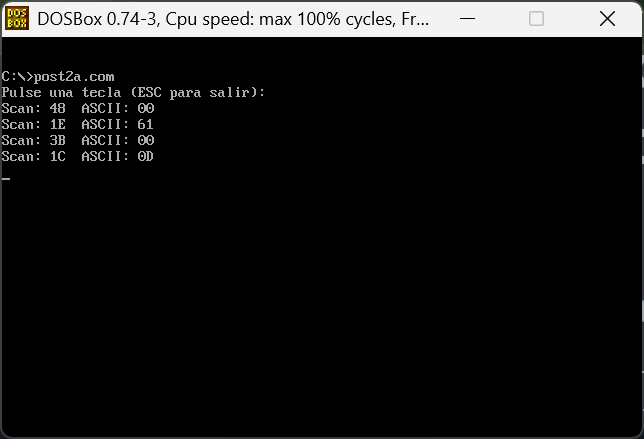

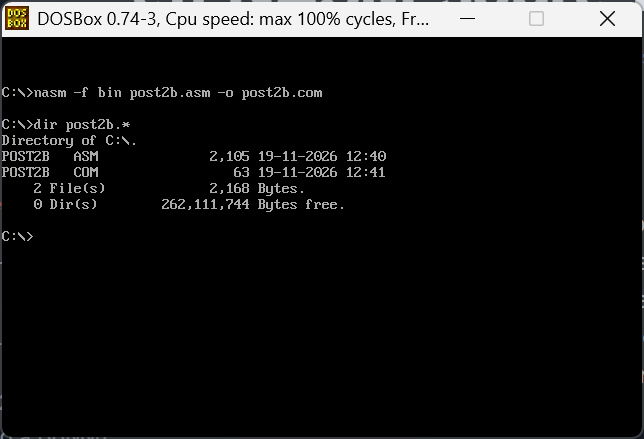
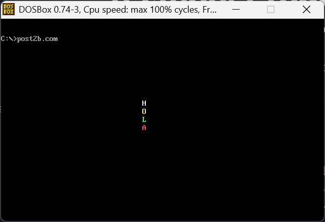

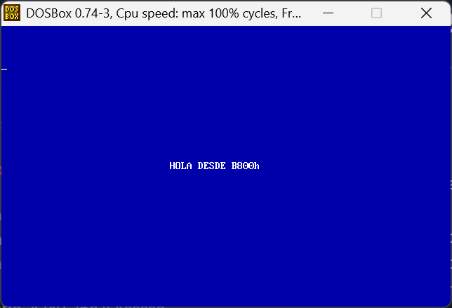

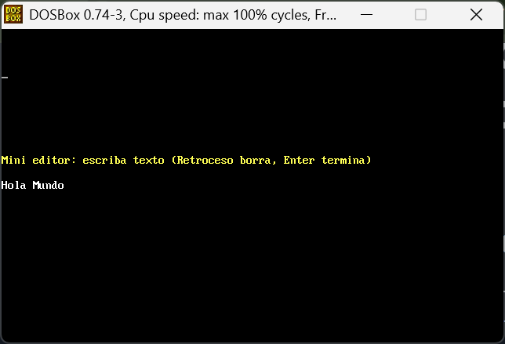
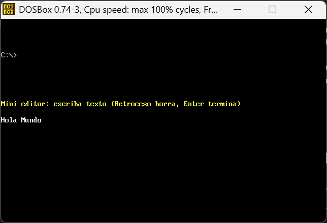

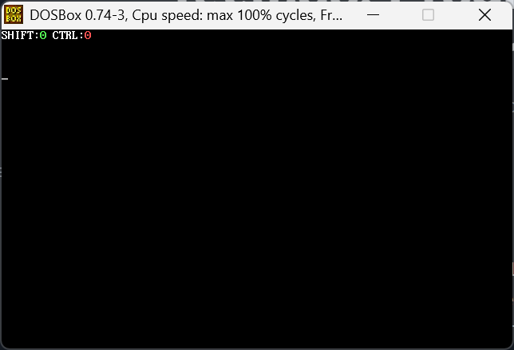

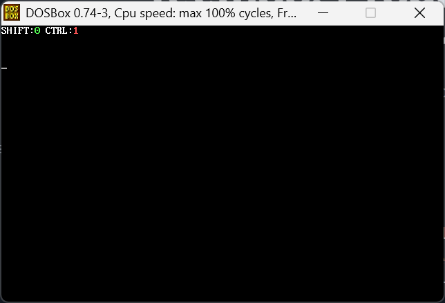
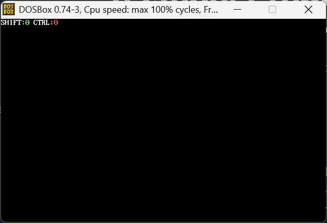

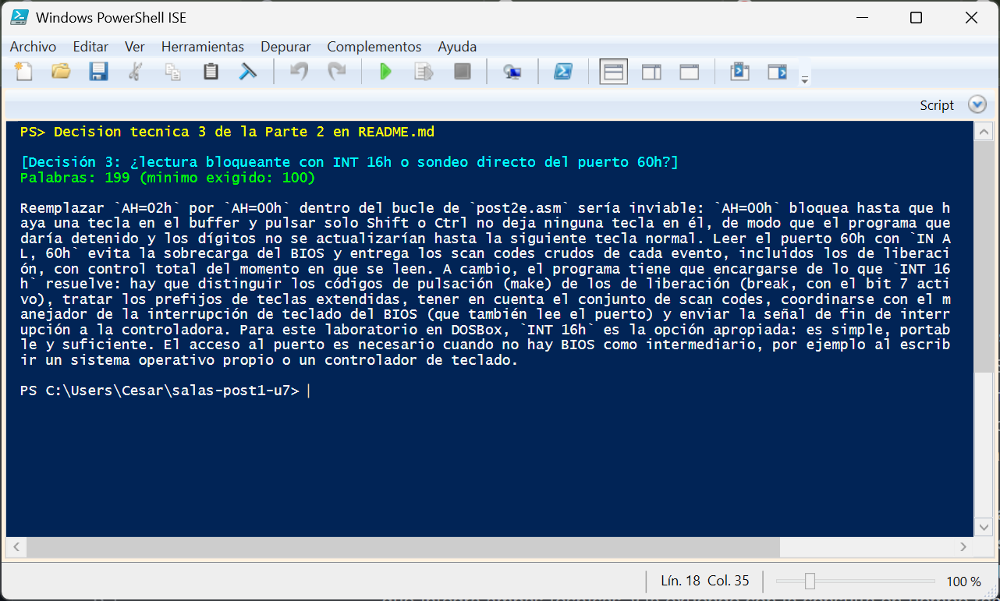
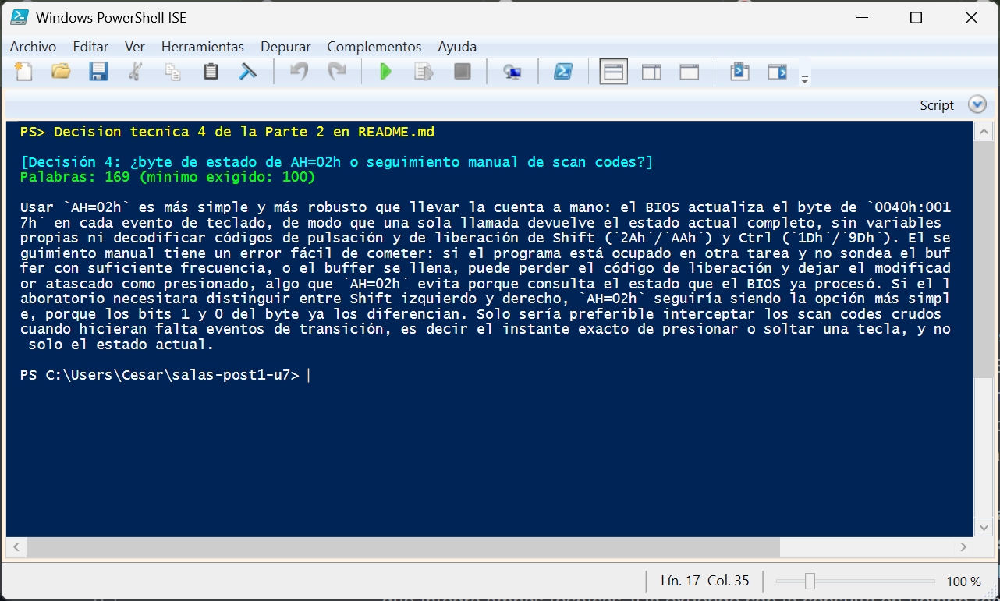

## Decisiones técnicas (Parte 2)

### Decisión 3: ¿lectura bloqueante con INT 16h o sondeo directo del puerto 60h?

Reemplazar `AH=02h` por `AH=00h` dentro del bucle de `post2e.asm` sería inviable: `AH=00h` bloquea hasta que haya una tecla en el buffer y pulsar solo Shift o Ctrl no deja ninguna tecla en él, de modo que el programa quedaría detenido y los dígitos no se actualizarían hasta la siguiente tecla normal. Leer el puerto 60h con `IN AL, 60h` evita la sobrecarga del BIOS y entrega los scan codes crudos de cada evento, incluidos los de liberación, con control total del momento en que se leen. A cambio, el programa tiene que encargarse de lo que `INT 16h` resuelve: hay que distinguir los códigos de pulsación (make) de los de liberación (break, con el bit 7 activo), tratar los prefijos de teclas extendidas, tener en cuenta el conjunto de scan codes, coordinarse con el manejador de la interrupción de teclado del BIOS (que también lee el puerto) y enviar la señal de fin de interrupción a la controladora. Para este laboratorio en DOSBox, `INT 16h` es la opción apropiada: es simple, portable y suficiente. El acceso al puerto es necesario cuando no hay BIOS como intermediario, por ejemplo al escribir un sistema operativo propio o un controlador de teclado.

### Decisión 4: ¿byte de estado de AH=02h o seguimiento manual de scan codes?

Usar `AH=02h` es más simple y más robusto que llevar la cuenta a mano: el BIOS actualiza el byte de `0040h:0017h` en cada evento de teclado, de modo que una sola llamada devuelve el estado actual completo, sin variables propias ni decodificar códigos de pulsación y de liberación de Shift (`2Ah`/`AAh`) y Ctrl (`1Dh`/`9Dh`). El seguimiento manual tiene un error fácil de cometer: si el programa está ocupado en otra tarea y no sondea el buffer con suficiente frecuencia, o el buffer se llena, puede perder el código de liberación y dejar el modificador atascado como presionado, algo que `AH=02h` evita porque consulta el estado que el BIOS ya procesó. Si el laboratorio necesitara distinguir entre Shift izquierdo y derecho, `AH=02h` seguiría siendo la opción más simple, porque los bits 1 y 0 del byte ya los diferencian. Solo sería preferible interceptar los scan codes crudos cuando hicieran falta eventos de transición, es decir el instante exacto de presionar o soltar una tecla, y no solo el estado actual.
