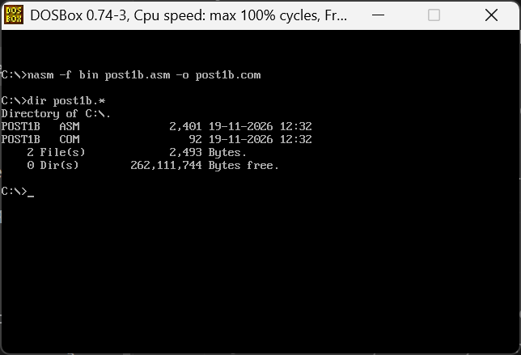
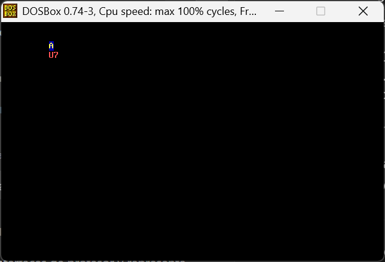
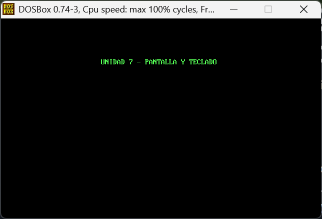
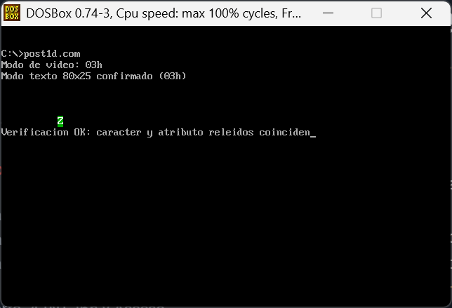
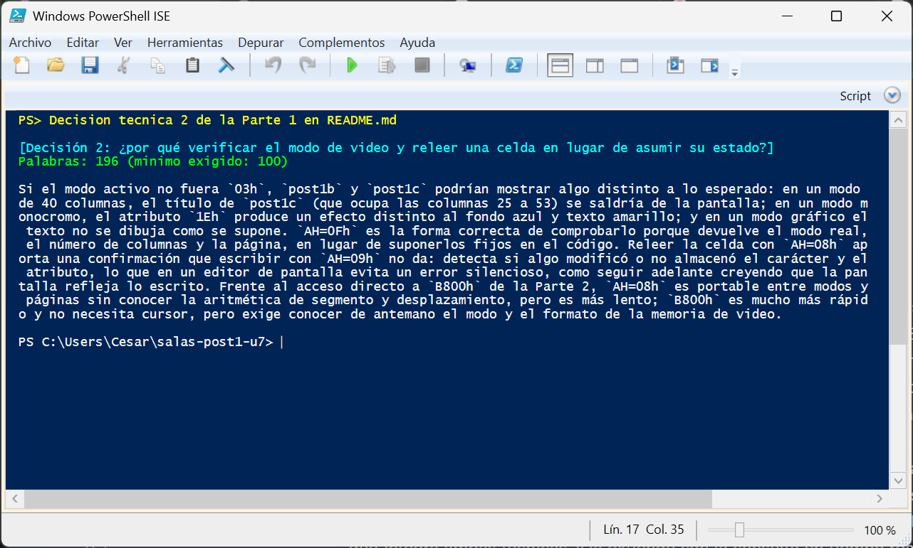

# salas-post1-u7

## Descripción

Laboratorio de la Unidad 7 de Arquitectura de Computadores (post-contenido): manejo de pantalla y teclado en NASM, ejecutado sobre DOSBox, en un único repositorio.

- **Estudiante:** Cesar Hernan Salas Peñaranda (cuenta de GitHub `cesarhernansp`)
- **Parte 1:** salida de texto con `INT 21h` y control de pantalla con `INT 10h` (cursor, color, cadenas en posición exacta), más la consulta del modo de video (`AH=0Fh`) y la relectura de una celda (`AH=08h`).
- **Parte 2:** lectura de teclado con `INT 16h` (scan codes y byte de estado `AH=02h`) y escritura directa en el segmento de video `B800h`, con un mini editor y un indicador de Shift/Ctrl en tiempo real.

## Entorno de trabajo

| Componente | Versión / detalle |
|---|---|
| Sistema anfitrión | Windows 11 Home, 16 GB de RAM |
| Emulador | DOSBox 0.74-3 |
| Ensamblador | NASM 3.02 para DOS (`nasm.exe`, requiere el host DPMI `cwsdpmi.exe`) |
| Editor | VS Code / editor de texto plano; archivos `.asm` en ASCII sin BOM |

`nasm.exe` y `cwsdpmi.exe` se copian a la raíz del proyecto (que se monta como `C:\`), pero no se versionan por ser binarios de terceros.

## Compilación y ejecución

```
Z:\> mount C C:\Users\Cesar\salas-post1-u7
Z:\> C:
C:\> cwsdpmi -p
C:\> nasm -f bin post1.asm -o post1.com
C:\> post1.com
```

La misma secuencia se aplica a cada programa (`post1b`, `post1c`, `post1d`, `post2a`, `post2b`, `post2c`, `post2d`, `post2e`). Todos los nombres respetan el formato 8.3 de DOS.

## Capturas

Las capturas de `capturas/` son imágenes de la ventana de DOSBox (o de la consola de Windows) tal como se obtuvieron, sin recortes, ampliaciones ni retoques.

## Estructura del repositorio

```
salas-post1-u7/
├── README.md       # documentación de ambas partes
├── dosbox.conf     # configuración de DOSBox
├── post1.asm/.com  post1b.asm/.com  post1c.asm/.com  post1d.asm/.com   # Parte 1
├── post2a.asm/.com post2b.asm/.com  post2c.asm/.com  post2d.asm/.com  post2e.asm/.com   # Parte 2
└── capturas/       # capturas de compilación y de ejecución de cada checkpoint
```

## Parte 1: INT 21h e INT 10h

Los cuatro programas son `.COM` (`ORG 100h`) con la estructura `section .data` / `section .text`. En `-f bin`, NASM coloca `.text` antes que `.data` en el archivo de salida aunque `.data` aparezca primero en el fuente (`post1.com` empieza con `B4 09`, es decir `mov ah, 09h`), de modo que la ejecución comienza en la primera instrucción.

### Interrupciones utilizadas

| Interrupción y función | Registros de entrada | Retorno / efecto | Dónde se usa |
|---|---|---|---|
| `INT 21h` / `AH=09h` | `DS:DX` → cadena terminada en `$` | imprime la cadena en el color actual de la pantalla; no admite atributo | `post1`, mensajes de `post1d` |
| `INT 21h` / `AH=02h` | `DL` = carácter | imprime un carácter | dígitos hexadecimales del modo en `post1d` |
| `INT 21h` / `AH=07h` | — | `AL` = tecla leída, sin eco; espera una pulsación | pausa final de `post1b`, `post1c` y `post1d` |
| `INT 21h` / `AH=4Ch` | `AL` = código de retorno | termina el programa | todos |
| `INT 10h` / `AH=06h` | `AL` = líneas (0 = limpiar), `BH` = atributo de relleno, `CX` = esquina superior izquierda, `DX` = inferior derecha | desplaza una ventana; con `AL = 0` y `DX = 184Fh` limpia toda la pantalla | `post1b`, `post1c` |
| `INT 10h` / `AH=02h` | `BH` = página, `DH` = fila, `DL` = columna | posiciona el cursor | `post1b`, `post1c`, `post1d` |
| `INT 10h` / `AH=09h` | `AL` = carácter, `BH` = página, `BL` = atributo, `CX` = repeticiones | escribe un carácter con atributo en la posición del cursor; **no** avanza el cursor | `post1b`, `post1c`, `post1d` |
| `INT 10h` / `AH=0Fh` | — | `AL` = modo de video activo, `AH` = columnas, `BH` = página activa | `post1d` |
| `INT 10h` / `AH=08h` | `BH` = página | `AL` = carácter y `AH` = atributo de la celda bajo el cursor (operación inversa de `AH=09h`) | `post1d` |

**Byte de atributo.** Los 4 bits altos son el color de fondo y los 4 bajos el color del texto. Por ejemplo `1Eh` = `0001 1110b` es fondo azul (1) con texto amarillo (E), `0Ch` es texto rojo claro sobre negro, `0Ah` es verde claro sobre negro y `2Fh` es fondo verde (2) con texto blanco brillante (F).

### Programas y resultados

| Programa | Qué hace | Resultado observado |
|---|---|---|
| `post1.asm` | Imprime tres cadenas con una sola función, `INT 21h` / `AH=09h` | Las tres líneas: `Arquitectura de Computadores`, `Unidad 7: Pantalla y Teclado`, `Laboratorio POST-1` |
| `post1b.asm` | Limpia la pantalla (`AH=06h`), posiciona el cursor (`AH=02h`) y escribe con color (`AH=09h`) | `A` amarilla sobre azul en la fila 2, columna 10; `U7` en rojo claro en la fila 3, columnas 10 y 11 |
| `post1c.asm` | Recorre una cadena posicionando el cursor y escribiendo un carácter con atributo en cada vuelta | `UNIDAD 7 - PANTALLA Y TECLADO` en verde claro, fila 5, desde la columna 25 (29 caracteres, centrado en 80 columnas) |
| `post1d.asm` | Consulta el modo con `AH=0Fh`, escribe `Z` con atributo `2Fh` y la relee con `AH=08h` | `Modo de video: 03h`, `Modo texto 80x25 confirmado (03h)`, `Z` en fila 8 columna 10 y `Verificacion OK: caracter y atributo releidos coinciden` |

### Notas de implementación

- **`post1d.asm` guarda el modo en memoria.** El código del enunciado deja el modo en `DL` y a continuación carga `DX` con la dirección de `msgModo`, lo que sobrescribe `DL`; la comparación con `03h` evaluaría entonces parte de una dirección y no el modo de video. El programa lo guarda en la variable `modo_video` y compara contra ese valor. Además imprime el modo en hexadecimal para que el reporte muestre explícitamente `03h`.
- **Constantes con nombre.** Los atributos de color, las filas y columnas de prueba, el modo esperado y los terminadores se definen con `equ` al inicio de cada programa, en lugar de usar valores mágicos.
- **`AH=09h` no mueve el cursor.** Por eso `post1b` reposiciona el cursor a mano antes de cada carácter y `post1c` incrementa la columna en `DL` en cada vuelta del bucle.

### Capturas de la Parte 1

Para cada checkpoint hay una captura de la compilación (`nasm -f bin ... ; dir`) y otra de la ejecución.

| Checkpoint | Compilación | Ejecución / verificación |
|---|---|---|
| 1. Salida básica (`post1`) | `capturas/p1_cp1a_compilacion_post1.png` | `capturas/p1_cp1b_ejecucion_post1.png` |
| 2. Cursor y color (`post1b`) | `capturas/p1_cp2a_compilacion_post1b.png` | `capturas/p1_cp2b_ejecucion_post1b.png` |
| 3. Cadena posicionada (`post1c`) | `capturas/p1_cp3a_compilacion_post1c.png` | `capturas/p1_cp3b_ejecucion_post1c.png` |
| 4. Modo de video y relectura (`post1d`) | `capturas/p1_cp4a_compilacion_post1d.png` | `capturas/p1_cp4b_ejecucion_post1d.png` |
| 5. Decisiones técnicas | `capturas/p1_cp5a_decision1.png` (recuento de palabras) | `capturas/p1_cp5b_decision2.png` (recuento de palabras) |











## Decisiones técnicas (Parte 1)

### Decisión 1: ¿INT 21h o INT 10h para esta salida de texto?

Como `INT 21h` / `AH=09h` no admite un atributo de color, usar `INT 10h` es obligatorio en `post1b`, `post1c` y `post1d`, que necesitan color por carácter, posiciones exactas o leer una celda; en `post1.asm`, en cambio, complicar el programa con `INT 10h` sería innecesario porque tres cadenas de texto plano se imprimen con tres llamadas a `INT 21h`. Imprimir una cadena larga sin color es más simple y rápido de programar con `INT 21h`: una sola llamada recorre toda la cadena hasta el `$`, mientras que `post1c` necesita un bucle que, por cada uno de los 29 caracteres, posiciona el cursor (`AH=02h`), escribe con atributo (`AH=09h`) y avanza el índice y la columna, es decir dos interrupciones por carácter más la lógica del bucle. Además, solo la ruta de `INT 10h` depende del modo de video: el atributo solo significa fondo y texto en un modo de texto a color como el `03h`, mientras que en un modo monocromo los mismos bits producen subrayado o vídeo inverso, y en un modo gráfico se interpretan como color de píxel. `INT 21h` nunca maneja atributos y se comporta igual en cualquier modo.

### Decisión 2: ¿por qué verificar el modo de video y releer una celda en lugar de asumir su estado?

Si el modo activo no fuera `03h`, `post1b` y `post1c` podrían mostrar algo distinto a lo esperado: en un modo de 40 columnas, el título de `post1c` (que ocupa las columnas 25 a 53) se saldría de la pantalla; en un modo monocromo, el atributo `1Eh` produce un efecto distinto al fondo azul y texto amarillo; y en un modo gráfico el texto no se dibuja como se supone. `AH=0Fh` es la forma correcta de comprobarlo porque devuelve el modo real, el número de columnas y la página, en lugar de suponerlos fijos en el código. Releer la celda con `AH=08h` aporta una confirmación que escribir con `AH=09h` no da: detecta si algo modificó o no almacenó el carácter y el atributo, lo que en un editor de pantalla evita un error silencioso, como seguir adelante creyendo que la pantalla refleja lo escrito. Frente al acceso directo a `B800h` de la Parte 2, `AH=08h` es portable entre modos y páginas sin conocer la aritmética de segmento y desplazamiento, pero es más lento; `B800h` es mucho más rápido y no necesita cursor, pero exige conocer de antemano el modo y el formato de la memoria de video.
